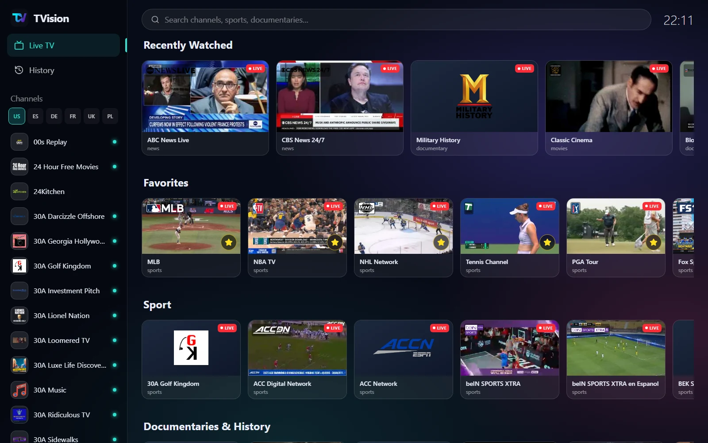

# TVision

TVision is a free live TV player for Windows. It turns the public channel lists
from [iptv-org](https://github.com/iptv-org/iptv) into a fast desktop player with
live previews, search, favorites, history, and automatic source failover.

[Live website](https://pcinkusz.github.io/tvision/) ·
[Download](https://github.com/PCinkusz/tvision/releases/latest) ·
[Source](https://github.com/PCinkusz/tvision)



## What it does

- 2,719 public channels across six catalogues: US, UK, Germany, France, Spain and Poland
- Live frames on channel tiles, with a muted preview on hover
- Focused rows for sport, documentaries, news, movies and entertainment
- Search across the full country catalogue as you type
- Favorites and viewing history stored only on your computer
- Automatic failover when a stream stops responding
- Windows 10 and 11, 64-bit, with no account and no analytics

TVision does not host, store, or distribute video. It plays public streams from
the broadcasters' own servers.

## Stack

- **Desktop:** Electron, React 19, Vite, Tailwind CSS 4, hls.js, react-virtuoso
- **Website:** React 19, Vite, Tailwind CSS 4, GSAP ScrollTrigger, beUI motion components

## Repository layout

```text
electron/        Electron main and preload processes
src/             Desktop renderer
scripts/         Channel data build and checks
build/           Application icon and installer assets
website/         Marketing site and its GitHub Pages build
.github/         Release and website workflows
```

## Development

Requires Node.js 22 or newer. Building the Windows installer is done on Windows.

```bash
npm ci
npm run dev            # renderer in the browser
npm run electron:dev   # Electron with Vite
npm run build          # renderer production build
npm run data           # validate the local channel data
npm run dist           # Windows NSIS installer
```

The website is a separate Vite project:

```bash
cd website
npm ci
npm run dev
npm run build
```

## Deployment

The website deploys to GitHub Pages from this repository using GitHub Actions.

One-time repository setup:

1. Make this repository public: **Settings → General → Danger Zone → Change visibility**.
2. Enable Pages: **Settings → Pages → Build and deployment → Source: GitHub Actions**.
3. Run the **site** workflow once from **Actions → site → Run workflow**.

After that, every push that changes `website/**` deploys automatically to:

```text
https://pcinkusz.github.io/tvision/
```

Installer releases are published to this repository by
`.github/workflows/release.yml`, so the website download button always points to
the latest build here. The old `tvision-releases` repository is retired.

## License

The source code is released under the [MIT License](LICENSE).

The copied beUI components and GSAP are covered by their own licenses; see
[THIRD_PARTY_NOTICES.md](THIRD_PARTY_NOTICES.md). The TVision name, logo, and
channel artwork are not covered by the MIT License.
